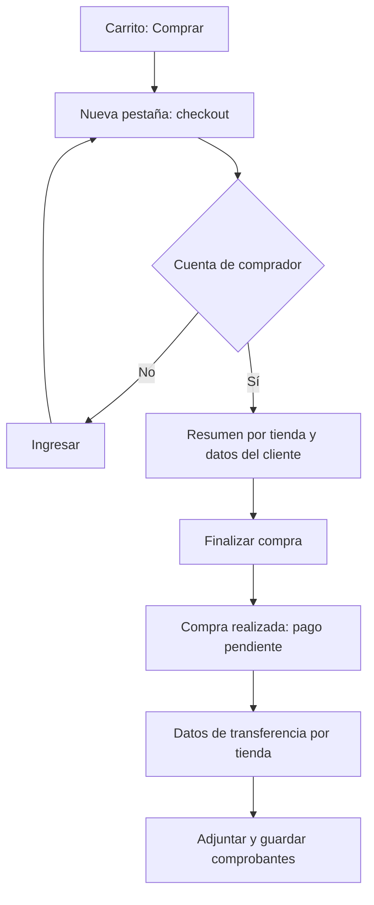

# Flujo — Compra por transferencia

## Actores
Comprador y tiendas destinatarias de las transferencias.

## Happy path
1. El cliente agrega productos y pulsa Comprar en el carrito.
2. Se abre /checkout en otra pestaña.
3. Se muestran los datos de la cuenta y el resumen agrupado por tienda.
4. Finalizar compra guarda una instantánea del pedido y actualiza el carrito entre pestañas.
5. Se muestra Compra realizada, número de pedido y pago pendiente.
6. Cada tienda muestra su importe, CVU o alias disponible y carga de comprobantes.
7. El cliente adjunta imágenes y recibe confirmación de guardado.

## Estados y excepciones
Carrito vacío con regreso al catálogo; sesión ausente con acceso al login de comprador; usuario feriante sin autorización para comprar; producto no disponible; tienda sin datos bancarios; archivo inválido; error de persistencia. Al recargar se conserva el pedido. Un comprobante adjunto no acredita el pago.

