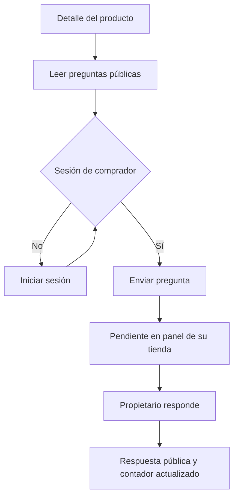

# Flujo — Preguntas por producto

## Actores
Visitante, comprador autenticado y feriante propietario.

## Recorrido
1. Abrir detalle del producto y leer preguntas y respuestas.
2. Sin sesión, pulsar Iniciá sesión para preguntar y usar el acceso existente.
3. Como comprador, escribir y enviar; mostrar confirmación y la consulta pública pendiente.
4. El feriante abre Preguntas en su panel y ve cliente, producto, fecha y consulta de su tienda.
5. Escribe y guarda respuesta; solo tras el éxito se retira la consulta de pendientes y baja el contador.
6. La respuesta permanece publicada junto a la pregunta en el producto.

## Estados
Sin preguntas, sin pendientes, carga, error recuperable, envío, éxito. Conservar borrador ante error y evitar doble envío.

## Permisos y excepciones
Solo comprador autenticado pregunta. Solo propietario responde. Rechazar texto vacío, producto inexistente y respuesta duplicada. No publicar correos ni identificadores de sesión.

