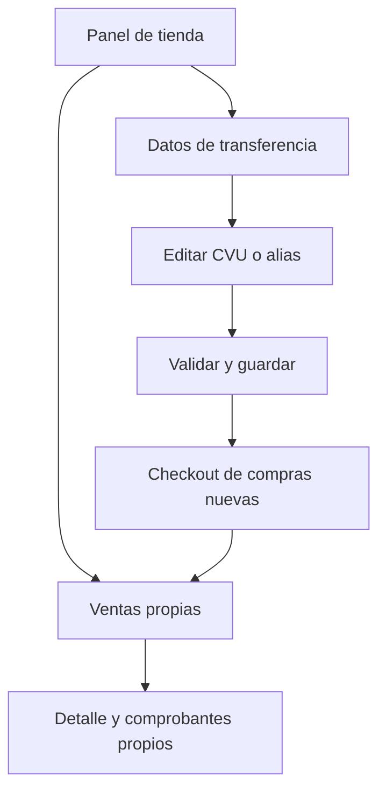

# Flujo — Ventas y datos de transferencia

## Actores y pantallas
Feriante autenticado en su panel; comprador en checkout.

## Recorrido
1. El feriante abre su panel y encuentra Ventas y Datos de transferencia.
2. Ventas muestra los pedidos más recientes primero, filtrados por su tienda.
3. Puede consultar productos, cliente, importe y ver los comprobantes adjuntos a su tienda.
4. Cargar/editar CVU o alias abre un formulario precargado con los datos existentes.
5. Guardar valida los datos y confirma el guardado; cancelar descarta cambios.
6. Las compras nuevas usan los datos guardados. Las compras ya confirmadas conservan su instantánea bancaria.
7. Una compra o nuevo comprobante en otra pestaña actualiza Ventas.

## Excepciones
Sin ventas: mensaje explicativo. Sin comprobantes: pendiente de adjuntar. Sin sesión de feriante: conservar pantalla de acceso restringido. Error de almacenamiento: conservar el formulario y permitir reintentar. Pago siempre pendiente de verificación; adjuntar un comprobante no acredita una transferencia.

